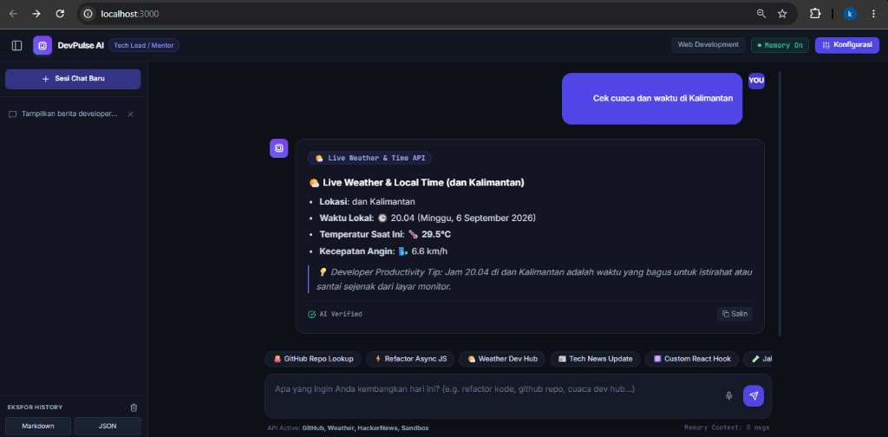
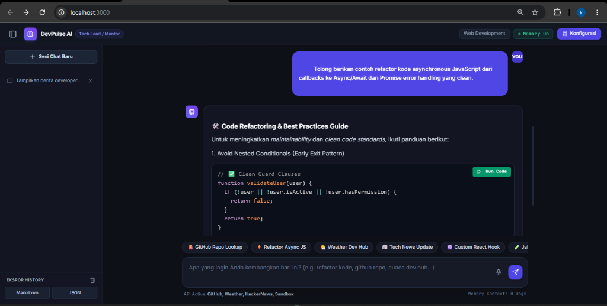
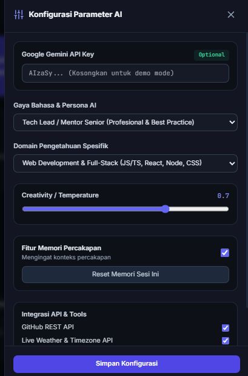

# DevPulse AI — AI Productivity & AI API Integration for Developers


**DevPulse AI** adalah aplikasi asisten kecerdasan buatan (*AI-powered developer productivity assistant*) yang dirancang dan dibangun oleh **KHALILURRAHMAN MAHDI** untuk membantu pengembang perangkat lunak meningkatkan produktivitas melalui bantuan AI, analisis kode, dan integrasi API eksternal.

Aplikasi ini menggabungkan antarmuka chatbot interaktif, konfigurasi parameter AI yang fleksibel, memori percakapan, serta berbagai alat bantu pengembangan dalam satu dashboard. Pengguna dapat menyesuaikan persona AI, domain pengetahuan, tingkat kreativitas, dan konfigurasi model sesuai kebutuhan pekerjaan.

DevPulse AI juga menyediakan integrasi dengan GitHub REST API, layanan cuaca dan waktu lokal, Hacker News API, serta *JavaScript code sandbox* untuk menjalankan potongan kode langsung dari antarmuka percakapan. Dukungan Google Gemini API dan *built-in fallback engine* memberikan fleksibilitas dalam menjalankan aplikasi.

---

## 🚀 Live Demo & Kode Sumber

- 💻 **Repository**: [DevPulse AI — GitHub](https://github.com/khalilurrahmanmahdi12/AI-Productivity-and-AI-API-Integration-for-Developers)
- 🌐 **Portfolio**: [https://khalildev.web.id/](https://khalildev.web.id/)
- 🖥️ **Local Development**: `http://localhost:3000`
- 📄 **Lisensi**: MIT License

---

## ✨ Fitur Utama

### 🎯 1. AI Customization & Creative Parameters

Sistem konfigurasi AI yang memungkinkan pengguna menyesuaikan gaya respons dan fokus pengetahuan sesuai kebutuhan pengembangan perangkat lunak.

- **Tech Lead / Mentor Senior**: Memberikan penjelasan mendalam, praktik terbaik, dan rekomendasi *clean code*.
- **Casual Developer**: Menggunakan gaya komunikasi santai, komunikatif, dan solutif.
- **Code Optimizer**: Memprioritaskan efisiensi algoritma, optimasi kode, dan analisis kompleksitas Big-O.
- **Formal & Structured**: Menghasilkan penjelasan sistematis dan dokumentasi terstruktur.
- **ELI5 (Explain Like I'm 5)**: Menjelaskan konsep teknis melalui analogi sederhana.
- **Domain Knowledge Selection**: Mendukung fokus Web Development, Data Science & AI/ML, DevOps & Cloud, System Design & Security, serta Career & Productivity.
- **Temperature Slider**: Mengatur tingkat kreativitas respons dari 0.0 hingga 1.0.

### 🧠 2. Conversation Memory

Fitur memori percakapan untuk mempertahankan konteks interaksi dalam satu rangkaian percakapan.

- Menyimpan dan menggunakan riwayat percakapan untuk mendukung interaksi multi-turn.
- Menampilkan indikator status memori pada antarmuka.
- Menyediakan fitur **Reset Memory** untuk menghapus konteks percakapan sesuai implementasi aplikasi.

### 🔌 3. External API Integration

Integrasi layanan eksternal untuk menyediakan informasi dan alat bantu pengembangan secara langsung.

- **GitHub REST API Inspector**: Mengambil informasi repositori publik, seperti jumlah stars, forks, open issues, lisensi, dan informasi profil pengembang.
- **Live Weather & Local Time**: Menampilkan informasi cuaca dan waktu lokal dari lokasi yang didukung layanan API.
- **Hacker News Developer Feed**: Menampilkan berita dan topik teknologi terkini melalui Hacker News API.
- **JavaScript Code Sandbox**: Menjalankan potongan kode JavaScript melalui antarmuka percakapan dengan dukungan penangkapan output console.

### ⚡ 4. Developer Productivity Tools

Kumpulan fitur tambahan untuk mempercepat aktivitas pengembangan perangkat lunak.

- **Prompt Templates**: Akses cepat ke prompt untuk refaktorisasi kode, React Hooks, pencarian GitHub, dan berita teknologi.
- **Chat Export**: Mengekspor riwayat percakapan ke format Markdown (`.md`) dan JSON (`.json`).
- **Voice Input**: Memasukkan pesan melalui fitur Speech-to-Text.
- **Syntax Highlighting**: Menampilkan potongan kode dengan pewarnaan sintaks melalui Prism.js.
- **Dual-Engine Support**: Mendukung integrasi Google Gemini API dan mesin fallback bawaan sesuai konfigurasi aplikasi.

### 🎨 5. Responsive Developer Dashboard

Antarmuka dirancang untuk memberikan pengalaman penggunaan yang konsisten pada desktop maupun perangkat seluler.

- Tata letak responsif untuk berbagai ukuran layar.
- Panel konfigurasi AI yang terstruktur.
- Tampilan percakapan yang mendukung teks, kode, dan hasil integrasi API.
- Navigasi dan komponen antarmuka yang berorientasi pada produktivitas pengembang.

---

## 🏗️ Arsitektur Sistem

DevPulse AI menggunakan arsitektur aplikasi web berbasis JavaScript dengan pemisahan tanggung jawab antara antarmuka pengguna, layanan AI, dan integrasi API eksternal.

```text
[1. User / Developer]
         |
         v
[2. DevPulse AI Web Interface]
         |
         v
[3. Application Logic & State]
         |
         +-----------------------------+
         |                             |
         v                             v
[4a. AI Service]              [4b. External API Services]
         |                             |
         +------------------+----------+
                            |
             +--------------+--------------+
             |              |              |
             v              v              v
       [Gemini API]    [GitHub API]   [Weather / News API]
             |
             v
      [Fallback Engine]
             |
             v
[5. Response Processing & Code Formatting]
             |
             v
[6. Chat Interface & Developer Tools]
             |
             v
[7. Chat Export / JavaScript Sandbox]
```

*Catatan: Diagram menggambarkan alur logis aplikasi. Pemanggilan layanan, mekanisme fallback, dan pengelolaan status mengikuti implementasi aktual pada kode sumber.*

---

## 📸 Screenshots User Interface

Dokumentasi visual aplikasi tersedia pada direktori `screenshots/` di repositori.

### 1. Live Weather & Local Time API Integration



Menampilkan integrasi layanan cuaca dan waktu lokal pada antarmuka aplikasi.

### 2. Code Refactoring & JavaScript Sandbox



Menampilkan interaksi bantuan kode dan fitur eksekusi JavaScript di dalam aplikasi.

### 3. AI Parameter Configuration



Menampilkan panel konfigurasi persona, domain pengetahuan, temperature, memori, dan API key.

---

## 🛠️ Teknologi yang Digunakan

- **JavaScript ES6+** — Logika aplikasi dan interaksi antarmuka.
- **Vite 5.4** — Development server dan build tool.
- **Tailwind CSS** — Styling antarmuka berbasis utility classes.
- **HTML5** — Struktur halaman aplikasi.
- **CSS3** — Styling khusus dan desain responsif.
- **Google Gemini API** — Integrasi model AI melalui API.
- **GitHub REST API** — Pengambilan informasi repositori dan profil publik.
- **Weather & Time API** — Integrasi informasi cuaca dan waktu lokal.
- **Hacker News API** — Pengambilan berita dan tren teknologi.
- **Prism.js** — Syntax highlighting untuk potongan kode.
- **Web Speech API** — Dukungan input suara apabila tersedia pada browser.
- **JavaScript Sandbox** — Eksekusi snippet JavaScript sesuai implementasi aplikasi.
- **Markdown & JSON** — Format ekspor riwayat percakapan.

---

## 🚀 Menjalankan Project

### Prasyarat

Pastikan perangkat telah memiliki:

- **Node.js**: versi 18.x atau lebih baru, sesuai kompatibilitas dependensi proyek.
- **npm**: pengelola paket Node.js.

### 1. Clone Repository

```bash
git clone https://github.com/khalilurrahmanmahdi12/AI-Productivity-and-AI-API-Integration-for-Developers.git

cd AI-Productivity-and-AI-API-Integration-for-Developers
```

### 2. Install Dependensi

```bash
npm install
```

### 3. Konfigurasi API Key

Jika menggunakan Google Gemini API, siapkan API key sesuai mekanisme konfigurasi yang digunakan proyek.

**Penting:** Jangan memasukkan API key aktif ke repository publik atau menyimpan kredensial sensitif langsung di kode frontend. Variabel lingkungan pada aplikasi frontend Vite tidak otomatis bersifat rahasia setelah aplikasi dibangun untuk production.

### 4. Jalankan Development Server

```bash
npm run dev
```

Buka URL yang ditampilkan oleh terminal. Jika konfigurasi Vite menggunakan port 3000, aplikasi dapat diakses melalui:

```text
http://localhost:3000
```

Jika port tersebut sedang digunakan, Vite dapat memilih port lain sesuai konfigurasi dan ketersediaan port.

### 5. Build untuk Production

```bash
npm run build
```

Hasil build production secara default tersedia di direktori `dist/`.

---

## 📂 Struktur Utama Project

```text
AI-Productivity-and-AI-API-Integration-for-Developers/
├── screenshots/
│   ├── 1_weather_api.png
│   ├── 2_code_refactor_sandbox.png
│   └── 3_ai_parameter_config.png
├── src/
│   ├── components/
│   │   └── PromptTemplates.js
│   ├── services/
│   │   ├── aiService.js
│   │   └── externalApis.js
│   ├── main.js
│   └── style.css
├── index.html
├── package.json
├── vite.config.js
├── README.md
└── LICENSE
```

*Catatan: Struktur di atas mengikuti struktur yang didokumentasikan untuk proyek ini. Jika terdapat perubahan direktori atau berkas pada repository, sesuaikan dokumentasi dengan struktur aktual.*

---

## 📌 Status Project & Fokus Pengembangan

- **AI Productivity**: Mengintegrasikan asisten AI dengan konfigurasi persona, domain pengetahuan, dan tingkat kreativitas.
- **External API Integration**: Menghubungkan aplikasi dengan layanan GitHub, cuaca, waktu lokal, dan berita teknologi.
- **Developer Tools**: Menyediakan template prompt, syntax highlighting, ekspor percakapan, serta JavaScript sandbox.
- **Conversation Context**: Mendukung interaksi multi-turn dengan fitur pengelolaan memori percakapan.
- **Responsive UI**: Mengutamakan pengalaman penggunaan yang konsisten pada desktop dan perangkat seluler.
- **Modular Architecture**: Memisahkan layanan AI, integrasi API, dan komponen antarmuka agar lebih mudah dipelihara.

---

## 👨‍💻 Developer & Creator

**KHALILURRAHMAN MAHDI**

*Software Engineer - Full Stack Developer*

- 🔗 **GitHub**: [github.com/khalilurrahmanmahdi12](https://github.com/khalilurrahmanmahdi12)
- 💼 **Portfolio**: [https://khalildev.web.id/](https://khalildev.web.id/)
- 📁 **Repository DevPulse AI**: [AI Productivity and AI API Integration for Developers](https://github.com/khalilurrahmanmahdi12/AI-Productivity-and-AI-API-Integration-for-Developers)

---

## ⭐ Dukungan

Jika DevPulse AI bermanfaat atau menarik bagi Anda, berikan ⭐ pada repository GitHub sebagai bentuk dukungan terhadap proyek ini.

